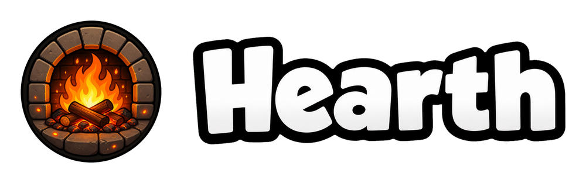
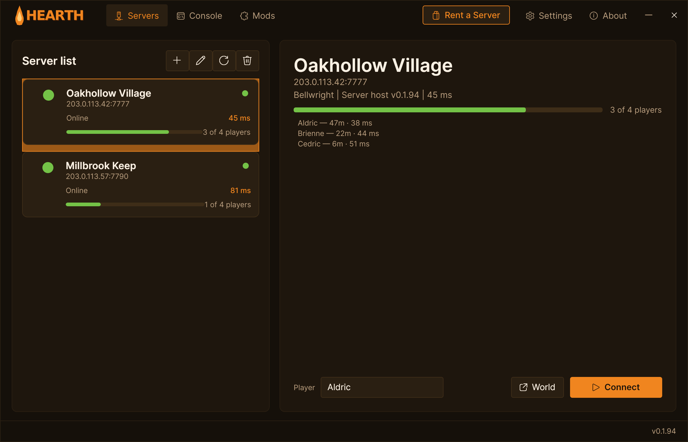
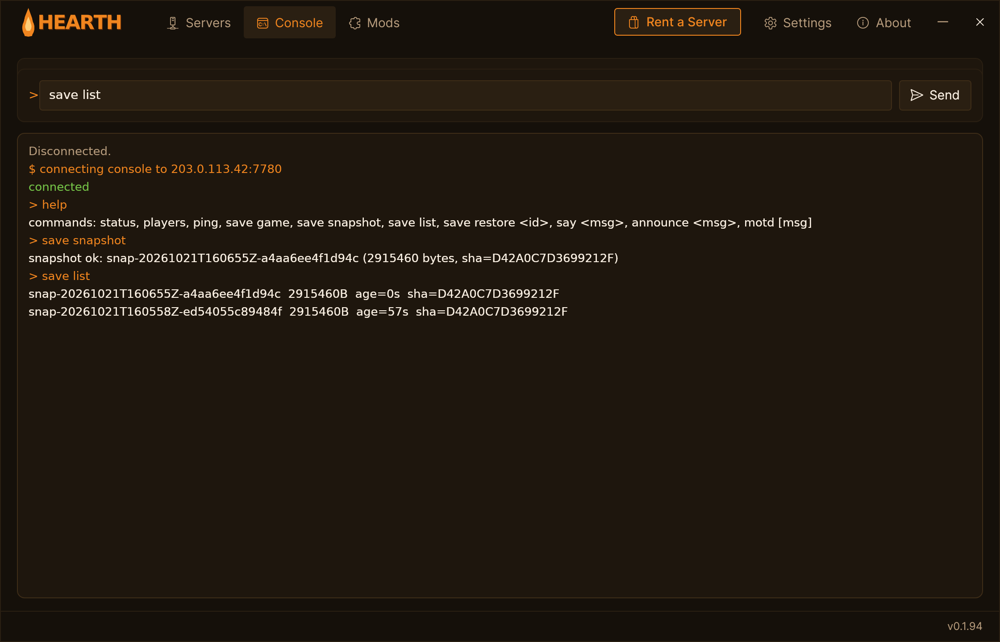

  

  
  
  
  
  

# Hearth

**Bellwright** has no dedicated server. Its multiplayer is co-op for up to four people, hosted from one player's copy of the game. Hearth adds a Bellwright dedicated server: [HearthServer](https://github.com/HumanGenome/HearthServer) runs the game headless on a Windows machine with a public IP and port, and the Hearth app connects players to it by address.

Every player must install Hearth to join a Hearth server. Stock Bellwright cannot connect to a Hearth server directly.

## Features

### 🧭 Join by IP
Add a server's IP and port once and press Connect. Hearth starts your own copy of Bellwright and joins the world directly: no Steam invite, and nobody has to be hosting from their PC. The server list shows whether each server is up, who is on it and for how long, and your ping.

  

### 🖥️ Admin console
The Console tab talks to the server's RCON port with its admin password: check the server and take, list and restore world snapshots without leaving the app. A restore snapshots the current world first, swaps the chosen one in and restarts Bellwright.

  

## What the server adds

These run on the server by themselves; players need nothing extra for them.

- **Map exploration and Travel Signs.** A server with no screen does not record where players have explored, and Travel Signs would lose their links. HearthServer writes each player's exploration into the world and keeps Travel Sign destinations on the map.
- **Gameplay settings from the server.** Raids, spoilage, damage, village needs and the rest of the game's 21 gameplay settings are set in a file on the server and applied through the game's own setters. On a dedicated host the in-game menu cannot save them.
- **Save checks.** Every autosave is checked before it can do damage. A player record the game drops while that player is offline is put back, a save set that slides back to a starter world is repaired before the next start, and a save left as zeros by a power loss is replaced by the newest intact copy.
- **Crash restarts.** The supervisor relaunches a game that crashes, and a stop or restart asks the game to save the world before it is closed.
- **Server query.** The server answers Source A2S query, so server lists, monitors and Discord bots can read its name, map and player count.

## Install

### Rent a server
[SurvivalServers.com](https://www.survivalservers.com/services/game_servers/bellwright/?utm_source=github&utm_medium=readme_install&utm_campaign=hearth) runs Bellwright servers with Hearth installed.

### Players
1. Download `HearthSetup-latest.exe` from the [latest release](https://github.com/HumanGenome/Hearth/releases/latest).
2. Run the installer. The installer is not code-signed, so Windows SmartScreen may warn; choose **More info**, then **Run anyway**. Hearth installs for your Windows user only and needs no admin rights.
3. Open Hearth, add the server's `ip:port`, and press **Connect**.

Hearth checks for its own updates when it starts, so you install it once.

### Self-hosted servers
The server side is open source at [HumanGenome/HearthServer](https://github.com/HumanGenome/HearthServer). Its release page ships `HearthServer-Host-Windows-x64-<version>.zip`, a complete host package. Extract it on a Windows machine with Windows 10 version 1909 or newer, Windows 11 or Windows Server 2022 (no GPU needed; Windows Server 2019 is not supported), install Bellwright on that machine from a Steam account that owns the game, edit `HearthServer\appsettings.json`, and run `host-instance.ps1 -GameRoot <your Bellwright folder>`. Ports, RCON and admin details are in that repository's README and `docs/ADMIN.md`.

## Releases

This repo publishes the player app:

- `HearthSetup-<version>.exe`: the installer
- `HearthSetup-latest.exe`: a stable download link that always points at the newest installer
- `Hearth-Launcher-Windows-x64-v<version>.zip`: the app without an installer
- `checksums-launcher.txt`: hashes for the files above

The host package (`HearthServer-Host-Windows-x64-v<version>.zip`) and the supervisor-only build are on the [HearthServer release page](https://github.com/HumanGenome/HearthServer/releases/latest).

## Source

- **Hearth** (this repo): the player app's downloads and documentation. The app itself is closed source.
- **[HearthServer](https://github.com/HumanGenome/HearthServer)**: the whole server side (the supervisor, the host mods, their native helpers, the signature packs and the launch script). Open source, MIT.

## FAQ

### Do players need to own Bellwright?
Yes. Hearth starts each player's own Steam copy of Bellwright and connects it to the server.

### Why can't I join with the game alone?
Bellwright only joins co-op sessions through Steam. Hearth adds a small client mod (installed with the app) that joins a server by address instead.

### What happens when Bellwright updates?
The server package and the app are rebuilt for each Bellwright build. Hearth updates itself when it starts; a self-hosted server should wait for the next HearthServer release before hosting on the new build.

### How many players can join?
Three at once. Bellwright's co-op is four places including the host, and the game sends world data to only three joining players; on a Hearth server the host is the server itself.

### Can I move a world to another server?
Yes. Take a snapshot on the old server and restore it on the new one; the steps are in [docs/WORLDS.md](docs/WORLDS.md). Use a snapshot, not a raw file copy. The world and everything in it move; each character stays tied to the Steam account that made it.

### Where is my character saved?
In the world on the server, tied to your Steam account rather than to the name you type in Hearth: the name box is a display name. See [docs/WORLDS.md](docs/WORLDS.md).

## Contributing

Report bugs in this repo's [issues](https://github.com/HumanGenome/Hearth/issues), for the app and the server alike. Include the Hearth and HearthServer versions and the relevant lines from the server's `Logs\bw_host.log`. Questions about a hosted server go to your hosting provider. Security issues go through [private reporting](https://github.com/HumanGenome/Hearth/security/advisories/new), never a public issue.

## Community Note

Hearth is a community project and is not affiliated with or endorsed by the developers of Bellwright.

## License

See [LICENSE](LICENSE).

## Credits

- [UE4SS](https://github.com/UE4SS-RE/RE-UE4SS): Unreal Engine scripting and modding framework
- [Avalonia](https://avaloniaui.net/): the UI framework the Hearth app uses
