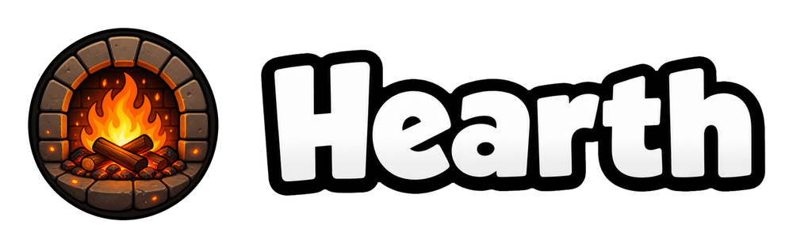
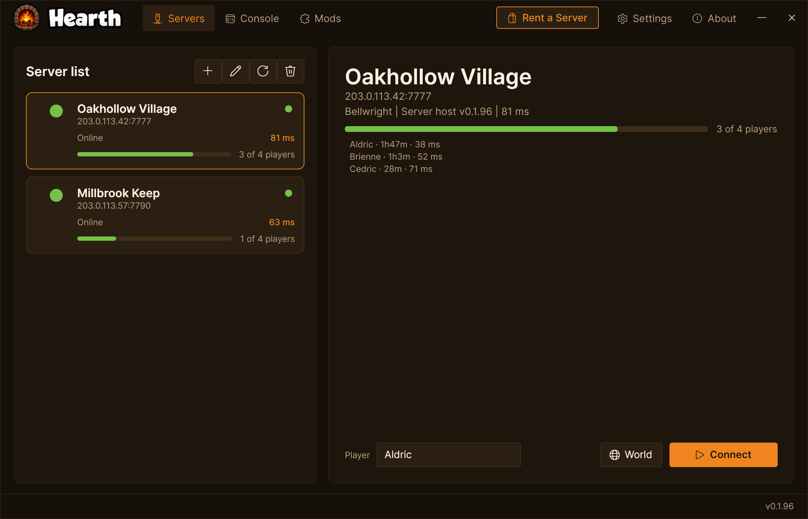
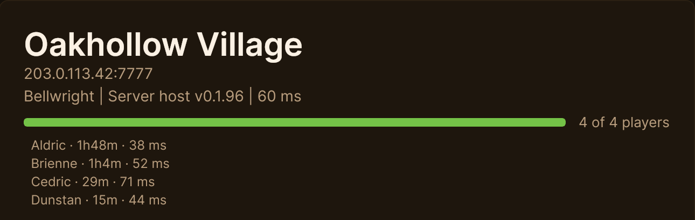
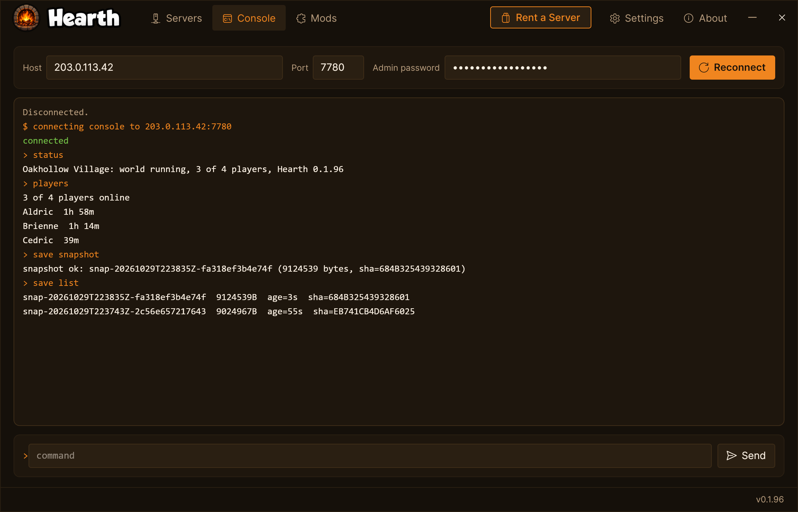

  

  
  
  
  
  

# Hearth

**Bellwright** has no dedicated server. Its multiplayer is co-op for up to four people, hosted from one player's copy of the game. Hearth adds a Bellwright dedicated server. Players join it by IP with the Hearth app.

Every player needs the Hearth app to join.

  

## Features

### 👥 Up to 4 players
On a server, the game keeps one of its four places for a hidden host. HearthServer gives that place to a fourth player.

  

### 🧭 Join by IP
Add a server's IP and port once and press **Connect**. Hearth starts your copy of Bellwright and joins the world, with no Steam invite. The server list shows whether each server is up, who is on it and for how long, and your ping.

  

### 💾 World backups
The **World** window lists the server's backups. Download one, restore an earlier one, upload a Bellwright save from your PC, or copy the newest backup from another server. Before a restore or an upload, the server backs up the current world, so you can go back to it.

  

### 🖥️ Server console
The **Console** tab runs admin commands with the server's admin password: check the server, see who is online, and make, list and restore backups.

  

### Also built in
- **Pause when empty.** When the last player leaves, the server saves the world and pauses it, so your settlement waits for you. It runs again the moment a player joins. The server owner can switch it off.
- **Map exploration and Travel Signs.** Each player's explored map is saved, and Travel Signs keep their links.
- **Gameplay settings.** Set raids, spoilage, damage, village needs and the rest of the game's 21 gameplay settings on the server.
- **Save checks.** Every autosave is checked. A character the game loses while its player is offline is put back, a save that went back to a starter world is repaired, and a save damaged by a power cut is replaced by the newest good copy.
- **Crash restarts.** The server starts Bellwright again if it crashes, and a stop or restart has the game save the world first.
- **Shows up in server lists.** Server lists, monitoring tools and Discord bots can read its name, map and player count.

## Install

### Rent a server
[SurvivalServers.com](https://www.survivalservers.com/services/game_servers/bellwright/?utm_source=github&utm_medium=readme_install&utm_campaign=hearth) runs Bellwright servers with HearthServer installed.

### Players
1. Download `HearthSetup-latest.exe` from the [latest release](https://github.com/HumanGenome/Hearth/releases/latest).
2. Run it. At "Windows protected your PC" choose **More info**, then **Run anyway**. Hearth installs for your Windows user only and needs no admin rights.
3. Open Hearth, press **+** and enter the server's IP and port.
4. Press **Connect**.

If Windows says Smart App Control blocked the installer, wait a day or two for Windows to recognize the new version and run it again, or turn Smart App Control off in Windows Security under App & browser control.

If the app closes to update and then won't open, download the installer from our website and run it again.

Hearth updates itself.

### Host your own
Download `HearthServer-Host-Windows-x64-v<version>.zip` from the [HearthServer release page](https://github.com/HumanGenome/HearthServer/releases/latest). It runs on Windows 10 (1909 or newer), Windows 11 or Windows Server 2022, with no graphics card. The server PC needs Bellwright from a Steam account that owns it. Setup, ports and settings: [HearthServer README](https://github.com/HumanGenome/HearthServer).

## Releases

Each release has:

- `HearthSetup-<version>.exe`: the installer
- `HearthSetup-latest.exe`: a download link that always points at the newest installer
- `Hearth-Launcher-Windows-x64-v<version>.zip`: the app without an installer
- `checksums-launcher.txt`: hashes for the files above

The server download is on the [HearthServer release page](https://github.com/HumanGenome/HearthServer/releases/latest).

## Source

- **Hearth** (this repo): the player app's downloads and documentation. The app itself is closed source.
- **[HearthServer](https://github.com/HumanGenome/HearthServer)**: the whole server side. Open source, MIT.

## FAQ

### How many players can join?
4 at once. Bellwright's co-op has four places, one of them for the host. A Hearth server has no player hosting, so HearthServer gives that place to a fourth player.

### Do players need to own Bellwright?
Yes. Hearth starts each player's own Steam copy of Bellwright and connects it to the server.

### Where is my character saved?
On the server, tied to your Steam account. Join from a new PC and you get the same character, with everything it carries. If Steam can't be reached when you join, a new PC starts a new character for that visit. See [docs/WORLDS.md](docs/WORLDS.md).

### Can I move a world to another server?
Yes. Make a backup on the old server and restore it on the new one. The steps are in [docs/WORLDS.md](docs/WORLDS.md). Use a backup, not a copy of the raw files. Each player should then join once from the PC they played on before. After that, their character follows their Steam account again.

### What happens when Bellwright updates?
Each Bellwright version needs its own Hearth release. The app updates itself. If you host your own server, wait for the new HearthServer release before you host on the new version.

### Why does Windows warn about the installer?
The installer is not code-signed, so Windows SmartScreen may show "Windows protected your PC". Choose **More info**, then **Run anyway**. You can check the file against the release's `checksums-launcher.txt`.

## Contributing

Bugs: open an [issue](https://github.com/HumanGenome/Hearth/issues) with your Hearth and HearthServer versions and the lines from the server's `Logs\bw_host.log`. Security problems go through [private reporting](https://github.com/HumanGenome/Hearth/security/advisories/new). Server code changes go to [HearthServer](https://github.com/HumanGenome/HearthServer).

## Community note

Hearth is a community project and is not affiliated with or endorsed by the developers of Bellwright.

## License

See [LICENSE](LICENSE): the documentation is MIT, the app's release files are closed source.

## Credits

- [UE4SS](https://github.com/UE4SS-RE/RE-UE4SS): Unreal Engine scripting and modding framework
- [Avalonia](https://avaloniaui.net/): the UI framework the Hearth app uses
