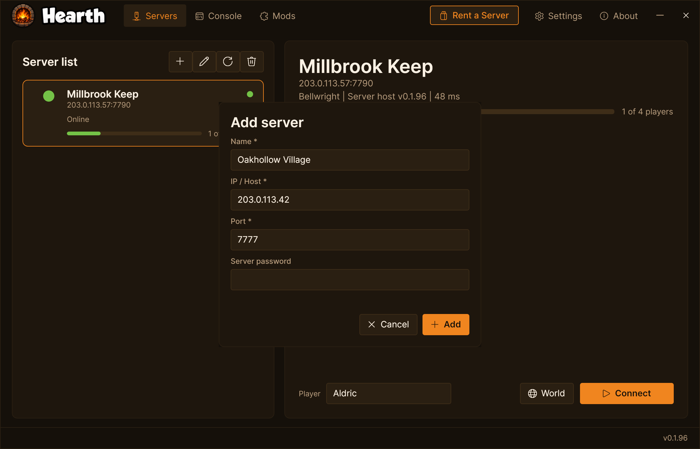
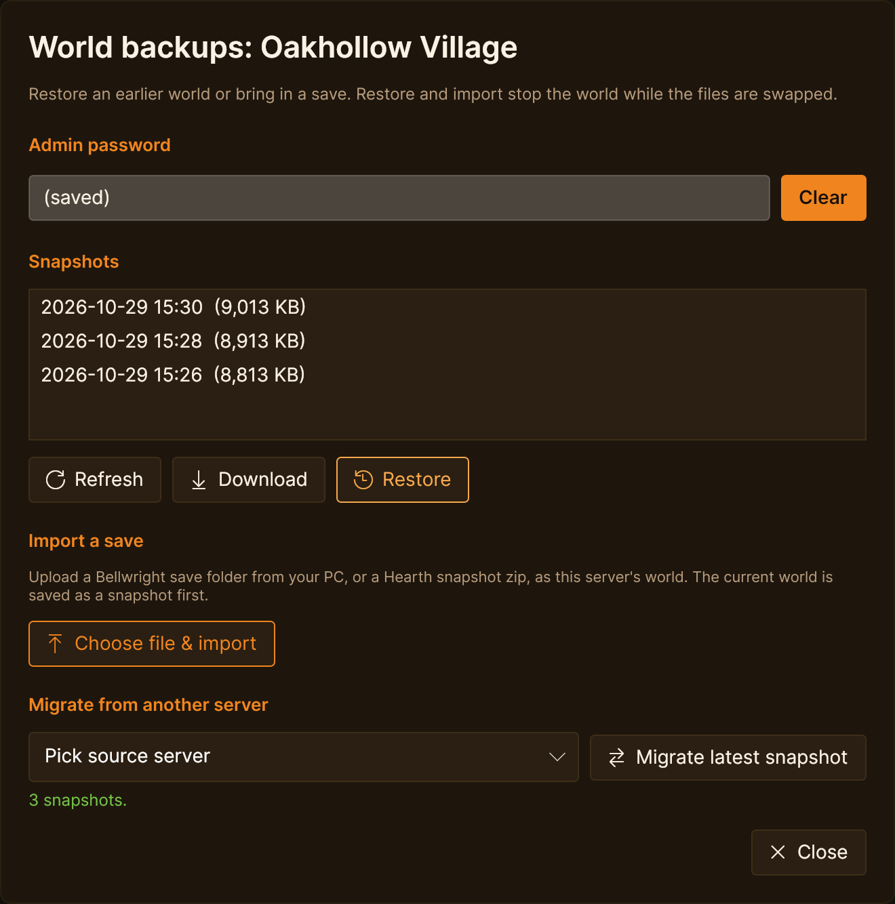

  

  
  
  
  
  

# Hearth

**Bellwright** has no dedicated server. Its multiplayer is co-op for up to four people, hosted from one player's copy of the game. Hearth adds a Bellwright dedicated server: [HearthServer](https://github.com/HumanGenome/HearthServer) runs the game headless on a Windows machine with a public IP and port, and the Hearth app connects players to it by address.

Every player must install Hearth to join a Hearth server. Stock Bellwright cannot connect to a Hearth server directly.

  

## Features

### 👥 Up to 4 players
Four players can be in the world at the same time, the same as Bellwright's own co-op. On a server the game would keep one of those places for its hidden host; Hearth gives that place to a fourth player.

  

### 🧭 Join by IP
Add a server's IP and port once and press Connect. Hearth starts your own copy of Bellwright and joins the world directly: no Steam invite, and nobody has to be hosting from their PC. The server list shows whether each server is up, who is on it and for how long, and your ping.

  

### 💾 World backups
The World window lists the server's snapshots of the world. Download one, put an earlier one back, upload a Bellwright save from your PC, or move the newest snapshot over from another server. Before a restore or an upload, the current world is saved as a snapshot, so you can go back to it.

  

### 🖥️ Server console
The Console tab connects to the server's admin console with its admin password. Check the server, see who is online, and take, list and restore world snapshots without leaving the app.

  

### Also built in
- **Pause when empty.** When the last player leaves, the server saves the world and pauses it, so your settlement waits for you. It runs again the moment a player joins. The server owner can switch it off.
- **Map exploration and Travel Signs.** A server with no screen does not record where players have explored, and Travel Signs would lose their links. HearthServer writes each player's exploration into the world and keeps Travel Sign destinations on the map.
- **Gameplay settings from the server.** Raids, spoilage, damage, village needs and the rest of the game's 21 gameplay settings are set on the server. On a dedicated host the in-game menu cannot save them.
- **Save checks.** Every autosave is checked. A player record the game drops while that player is offline is put back, a save that slides back to a starter world is repaired before the next start, and a save left as zeros by a power loss is replaced by the newest intact copy.
- **Crash restarts.** The server starts Bellwright again if it crashes, and a stop or restart has the game save the world first.
- **Shows up in server lists.** The server answers Source server query, so server lists, monitors and Discord bots can read its name, map and player count.

## Install

### Rent a server
[SurvivalServers.com](https://www.survivalservers.com/services/game_servers/bellwright/?utm_source=github&utm_medium=readme_install&utm_campaign=hearth) runs Bellwright servers with Hearth installed.

### Players
1. Download `HearthSetup-latest.exe` from the [latest release](https://github.com/HumanGenome/Hearth/releases/latest).
2. Run it. At "Windows protected your PC" choose **More info**, then **Run anyway**. Hearth installs for your Windows user only and needs no admin rights.
3. Open Hearth and add the server's IP and port.
4. Press **Connect**.

Hearth checks for its own updates when it starts, so you install it once.

### Self-hosted servers
The server side is open source at [HumanGenome/HearthServer](https://github.com/HumanGenome/HearthServer). Its release page has `HearthServer-Host-Windows-x64-v<version>.zip`, a complete host package for Windows 10 version 1909 or newer, Windows 11 or Windows Server 2022 (no GPU needed). The host needs Bellwright installed from a Steam account that owns the game. Setup, ports and settings are in that repository's README.

## Releases

This repo publishes the player app:

- `HearthSetup-<version>.exe`: the installer
- `HearthSetup-latest.exe`: a download link that always points at the newest installer
- `Hearth-Launcher-Windows-x64-v<version>.zip`: the app without an installer
- `checksums-launcher.txt`: hashes for the files above

The server package is on the [HearthServer release page](https://github.com/HumanGenome/HearthServer/releases/latest).

## Source

- **Hearth** (this repo): the player app's downloads and documentation. The app itself is closed source.
- **[HearthServer](https://github.com/HumanGenome/HearthServer)**: the whole server side (the supervisor, the host mods, their native helpers and the launch script). Open source, MIT.

## FAQ

### How many players can join?
Four at once. Bellwright's co-op has four places including the host, and the game sends world data to only three joining players. A Hearth server has no player hosting it, so it frees the host's place and sends the fourth player that data itself. Four players have played on one Hearth server at the same time.

### Does everyone need the app?
Yes. Bellwright only joins co-op sessions through Steam. Hearth adds a small client mod, installed with the app, that joins a server by address instead.

### Do players need to own Bellwright?
Yes. Hearth starts each player's own Steam copy of Bellwright and connects it to the server.

### Where is my character saved?
In the world on the server, and it follows your Steam account: join from a new or renamed PC and you get the same character, with everything it carries. Hearth checks your account with Steam each time you join. With an older Hearth, or when Steam cannot be reached, you join the old way, and a new PC then starts a new character for that visit. See [docs/WORLDS.md](docs/WORLDS.md).

### Can I move a world to another server?
Yes. Take a snapshot on the old server and restore it on the new one; the steps are in [docs/WORLDS.md](docs/WORLDS.md). Use a snapshot, not a raw file copy. The world and everything in it move. The new server does not yet know whose character is whose, so each player should make their first join from the PC they played on before; after that, the character follows their Steam account again.

### What happens when Bellwright updates?
The server package and the app are rebuilt for each Bellwright build. Hearth updates itself when it starts; a self-hosted server should wait for the next HearthServer release before hosting on the new build.

### Why does Windows warn about the installer?
The installer is not code-signed, so Windows SmartScreen may show "Windows protected your PC". Choose **More info**, then **Run anyway**. You can check the file against the release's `checksums-launcher.txt`.

### Is this official?
No. Hearth is an independent project, not made by the developers of Bellwright.

### Something broke
Open an [issue](https://github.com/HumanGenome/Hearth/issues) with the Hearth and HearthServer versions and the relevant lines from the server's `Logs\bw_host.log`. If you rent a server, your host's support can help first.

## Contributing

Bug reports for the app and the server alike go in this repo's [issues](https://github.com/HumanGenome/Hearth/issues). Security issues go through [private reporting](https://github.com/HumanGenome/Hearth/security/advisories/new), never a public issue. Server code changes go to [HearthServer](https://github.com/HumanGenome/HearthServer).

## Community note

Hearth is a community project and is not affiliated with or endorsed by the developers of Bellwright.

## License

See [LICENSE](LICENSE): the documentation is MIT, the app's release files are closed source.

## Credits

- [UE4SS](https://github.com/UE4SS-RE/RE-UE4SS): Unreal Engine scripting and modding framework
- [Avalonia](https://avaloniaui.net/): the UI framework the Hearth app uses
